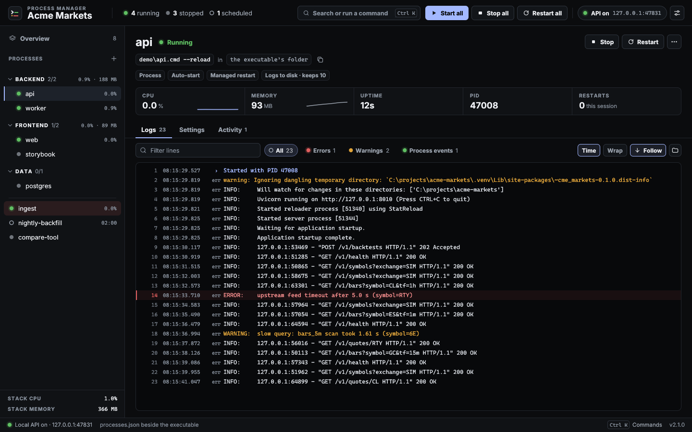
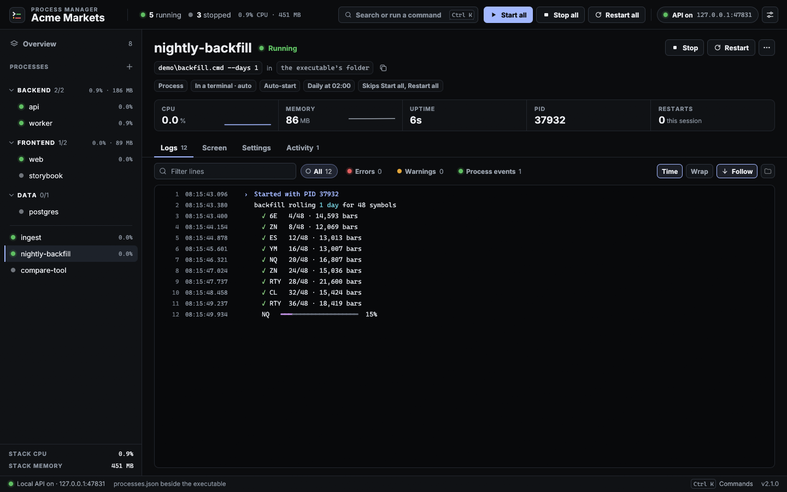
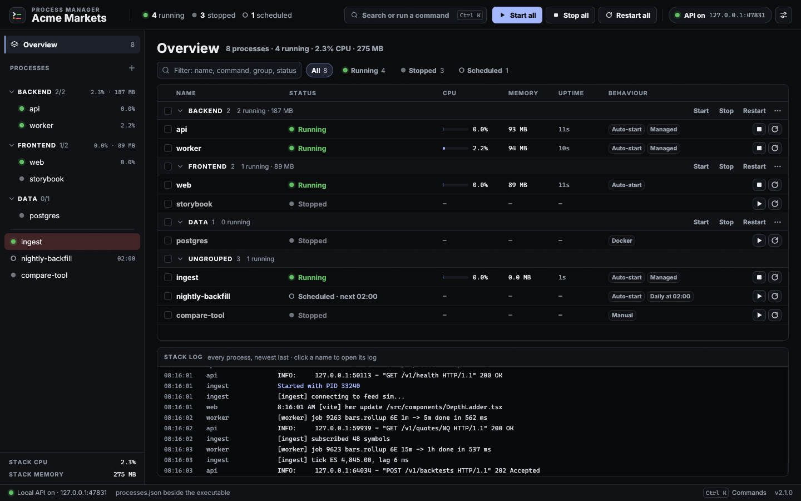
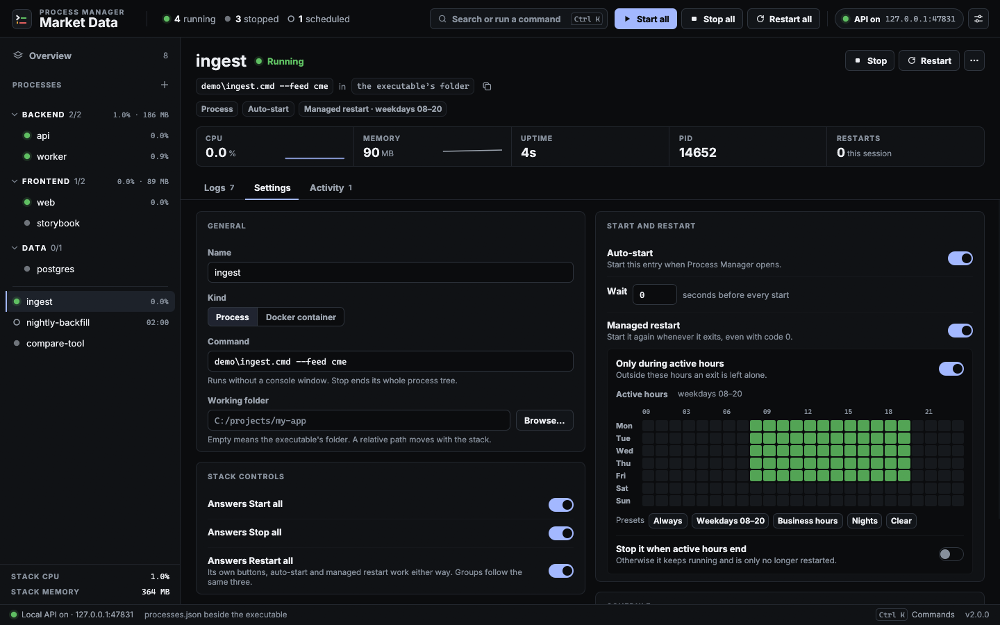
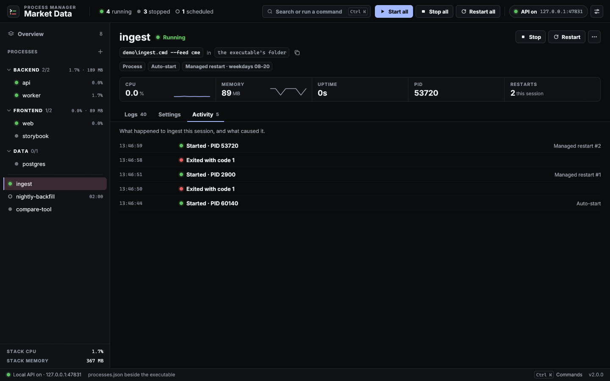
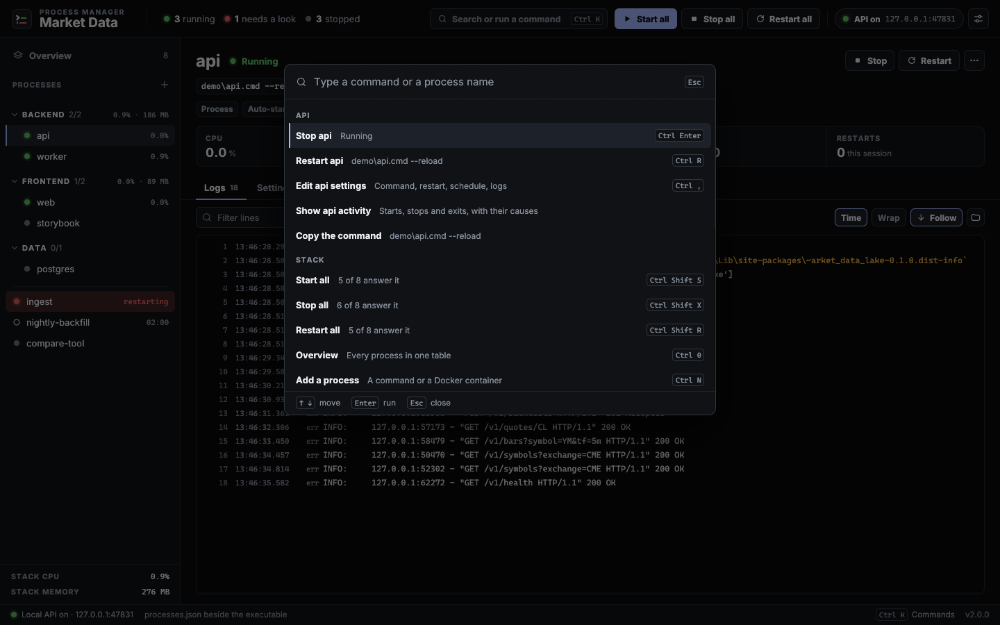
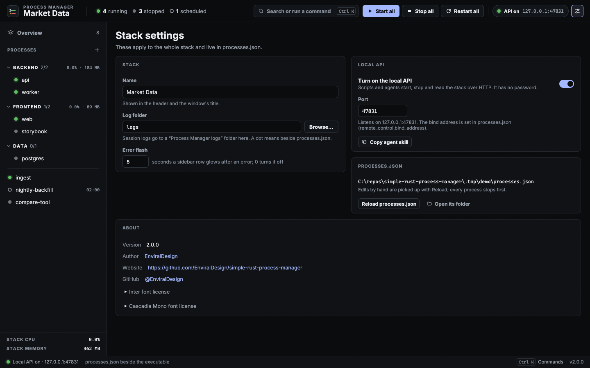
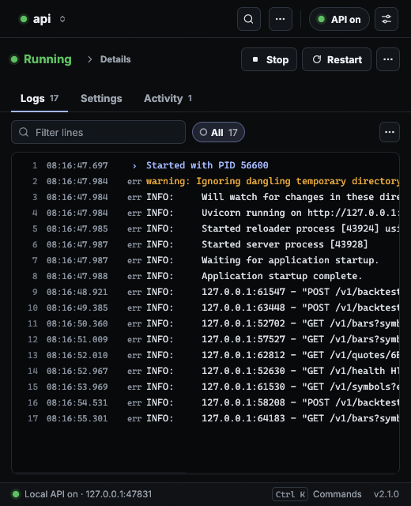

# Simple Rust Process Manager

A native desktop process manager for developers who want one place to run a stack, watch logs, restart flaky services, and stop everything cleanly.

It is built for the annoying real-world cases:

- mixed stacks like `npm`, `uv`, scripts, and Docker containers
- runaway child processes that do not die when the parent exits
- local tools that need a loopback API for agents, scripts, or automation
- dev environments where fast feedback matters more than infrastructure theater


## Why Use It

- Start your full local stack from one window instead of juggling terminals.
- Watch live, searchable output for any process, with errors and warnings picked out.
- See the whole stack at once: what runs, what crashed, what it costs in CPU and memory.
- Restart unstable services automatically with managed restart and optional active hours.
- Start dormant services from simple per-process schedules.
- Organize related processes into one-layer groups with aggregate CPU/RAM and group controls.
- Stop process trees on Windows and macOS, including child-process chains.
- Mix normal commands and Docker containers in the same stack.
- Expose an optional localhost-only REST API for tooling and AI agents.
- Do everything from the keyboard: Ctrl/Command+K opens a command palette.

## What It Looks Like

### Console

Each process gets a console: its status in plain words, the command and where it runs, what it is set to do, live CPU, memory, uptime, PID and restarts, and its log.



- Status reads as a sentence: `Running`, `Exited with code 1 · restarting`, `Scheduled · next 02:00`, `Failed to start`.
- Logs show line numbers and times; stderr is tagged `err` instead of prefixed, so a server that logs INFO to stderr no longer looks broken.
- Chips filter errors, warnings and Process Manager's own events, with counts; the filter field searches and highlights.
- Follow keeps the newest line in view and lets go when you scroll up; a "new lines" button brings you back.
- Click a line to select it, Shift-click for a range, Ctrl/Command+C to copy; double-click a line to select its text.
- Output is kept across restarts, so a crash's traceback is still there after managed restart brings the process back.

### Terminals

Tools with rich output (Python's Rich, progress bars from pip, cargo or npm, coloured test runners) and full-screen programs (Textual apps, htop, lazygit, REPLs) check whether they are talking to a terminal. Through plain pipes they are not, so they drop their colour, hold back their progress bars, buffer their output or refuse to start. A process's **Output** setting can run it in a terminal instead (ConPTY on Windows, a pseudo-terminal on macOS) that Process Manager emulates:

- **Plain output**: pipes, as before. The default, and what every `processes.json` without the setting gets.
- **Terminal (auto)**: for anything that wants a terminal, TUIs included. The log keeps the program's colours, and a progress bar or a live table updates its line in place instead of printing a hundred copies. When the program goes full screen, the console switches to its **Screen** tab, and back to the log when it leaves.
- **Terminal (screen first)**: for interactive tools such as REPLs and prompts, which never go full screen. The console always opens on the Screen tab.



The Screen tab draws the program's screen. Click it to type: keys, paste and the mouse go to the program, and the window's shortcuts wait until you click outside the screen. **Ctrl C** interrupts it, **Copy screen** copies its text. A terminal process's lines still reach the log (rows that scroll by, or have been still for a moment, are written to disk and checked for errors); what a full-screen program draws does not. New terminals start at the size of the log area (at least 100 × 24); full-screen programs follow the Screen tab's size.

### Overview

Every process in one table under its group, with a filter, state chips, group controls and checkbox bulk actions. The stack log underneath merges every process's output by time.



### Settings, in place

A process's settings are a tab of its console, not a dialog. Changes collect until you save them; leaving with unsaved changes asks first. The active-hours grid takes clicks and drags.



### Activity

What happened to a process this session, and what caused it: auto-start, Start all, you, the local API, managed restart, the schedule.



### Command palette

Ctrl/Command+K finds any process or action by name.



### Stack settings

Stack name, log folder, error flash, the local API and the config file, edited in place.



### Small windows

The layout steps down as the window narrows. Below 760 points the sidebar folds into a switcher in the header and the console leads with the status; the command and badges wait behind Details; the stats strip steps aside in short windows; log chips and toggles fold into menus. The log keeps the room.



## Core Functionality

### Stack Control

- Start, stop, and restart the whole stack from the header (or Ctrl/Command+Shift+S, X, R).
- Start, stop, restart, edit, duplicate or delete individual entries from the console, the sidebar's context menu, the overview, or the palette.
- Reorder processes by dragging them in the sidebar; a line previews where the row lands.
- Keep one-off entries independent by turning off their Start all, Stop all and Restart all participation; the badges say which a process skips.
- Keep a mixed stack of regular commands and Docker containers in one place.

### Groups

- Shift-click (or Ctrl/Command-click) processes in the sidebar, or check them in the overview, then Make a group.
- Group headers collapse, show running counts and aggregate CPU/RAM, and offer Start, Stop and Restart, each honoring its members' matching stack-control setting.
- Rename or ungroup from the group's menu.

### Resilience

- Managed restart brings an entry back whenever it exits, optionally only within weekly active hours, and optionally stops it when the hours end.
- Scheduled runs start dormant entries hourly, every N hours, daily, or on chosen weekdays.
- Auto-start brings entries up when Process Manager launches, after an optional startup delay.
- On Windows, process trees stop with Job Objects. On macOS, each managed command runs in its own process group; stopping sends SIGTERM, then SIGKILL after a one-second grace period.
- Docker behavior stays explicit: regular processes are shut down on app close, containers persist unless you stop them.

### Configuration Without Friction

- Store config in a portable `processes.json` next to the executable or Mac `.app`; Mac apps installed in Applications use Application Support.
- Edit entries in place; relative working folders are offered when a folder sits near the executable, so a stack can move as a folder.
- Persist logs to disk per process, with configurable retention.
- Migrate older config files forward automatically.

### Tooling and Automation

- Enable a localhost-only REST API for scripts, dashboards, and agents.
- Copy an agent skill that includes the address, endpoints, and process ids.
- Use stable process ids for reliable external control; actions taken through the API show as "Local API" in a process's activity.
- Edit the `groups` array in `processes.json` and call `POST /stack/reload` to apply changes.

## Quick Start

### From Source

```bash
git clone https://github.com/EnviralDesign/simple-rust-process-manager.git
cd simple-rust-process-manager
cargo build --release
```

Output binary:

- Windows: `target/release/simple-rust-process-manager.exe`
- Linux/macOS: `target/release/simple-rust-process-manager`

### Prebuilt Binaries

See the [Releases](https://github.com/EnviralDesign/simple-rust-process-manager/releases) page.

## macOS

Build and run from source with a current stable Rust toolchain and Xcode Command Line Tools:

```sh
cargo run --locked
```

Create a native app and distribution ZIP:

```sh
./scripts/package-macos.sh
open "dist/Process Manager.app"
```

The script produces `dist/Process Manager.app` and a versioned, architecture-specific ZIP. Run the app directly from your stack folder for portable use. The bundle declares macOS 12 or newer; the workflow tests current macOS runners, while macOS 12 itself still requires device validation.

The Mac app follows the Windows portable layout by default:

- Config: `processes.json` beside `Process Manager.app` (for example, `dist/processes.json`).
- Default logs: `Process Manager logs/` beside the app.
- Diagnostics, when enabled: `process-manager-diagnostics.log` beside the app.
- Relative log paths resolve from that same configuration directory.
- To run independent stacks, put a copy of the app and its `processes.json` in each stack's folder. Give each instance a different local API port if the API is enabled. App copies in the same folder share that folder's configuration, matching Windows executables.
- Moving a portable app means moving its configuration/logs with it. Updating the app in place preserves the adjacent configuration.
- If the app is placed under `/Applications`, `~/Applications`, or `/System/Applications`, config and default logs instead use `~/Library/Application Support/Simple Rust Process Manager/`. Installed copies share that directory.
- If you used the earlier Mac build's shared Application Support config, copy that `processes.json` beside the portable app while the app is closed. New portable copies do not automatically import a shared stack.

Other Mac behavior:

- Finder launches recover PATH from your configured interactive login shell, with Homebrew, `~/.local/bin`, and `~/.cargo/bin` fallbacks. Shell initialization has a three-second timeout. The command field does not expand `$VARIABLE` or `~`; use full paths or an explicit shell when needed.
- Keyboard shortcuts use Command on macOS and Ctrl on Windows.
- CPU/RAM totals include members of the managed process group. CPU percentage is normalized across logical processors, matching Windows.
- Docker Desktop (or another configured Docker engine) must be running for container entries. Containers persist when the app closes, as on Windows.

Process groups cover normal development commands and their descendants. Programs that deliberately detach into a new session/group escape this cleanup; run those in foreground mode. Unlike Windows Job Objects, Unix process groups do not automatically kill children if the manager itself is forcibly killed.

### Intel and universal apps

Install additional targets with rustup when needed:

```sh
rustup target add aarch64-apple-darwin x86_64-apple-darwin
./scripts/package-macos.sh x86_64-apple-darwin
./scripts/package-macos.sh universal
```

Universal packaging builds both architectures and combines them with `lipo`. Native packaging works with Homebrew Rust too; additional targets require a toolchain that supplies their standard libraries.

### Signing and notarization

Local and CI builds use an ad-hoc signature. Public distribution requires your Apple Developer ID Application certificate and notarization credentials. The packaging script supports both using an existing signing identity and a stored `notarytool` keychain profile:

```sh
MACOS_SIGNING_IDENTITY="Developer ID Application: Your Name (TEAMID)" \
MACOS_NOTARY_PROFILE="process-manager" \
./scripts/package-macos.sh
```

The script signs with hardened runtime, submits the app to Apple, staples and validates the ticket, and archives the stapled app. Create the keychain profile using `xcrun notarytool store-credentials` before packaging; credentials stay out of the repository. See [Apple's notarization workflow](https://developer.apple.com/documentation/security/customizing-the-notarization-workflow).

### Automated builds and releases

`.github/workflows/build.yml` tests and packages Windows, Apple Silicon macOS, and Intel macOS for pushes and pull requests. Each job uploads its ZIP. Pushing a `v*` tag assembles the successful builds into a draft GitHub release for review; the tag must match the version in `Cargo.toml` and have an entry in `CHANGELOG.md` (see `AGENTS.md`). Mac CI artifacts are ad-hoc signed; run the signing/notarization flow above before public distribution. `Cargo.lock` is committed so these builds use the same dependency versions.

Windows packaging can also be run locally:

```powershell
./scripts/package-windows.ps1
```

## Basic Workflow

1. Launch the app. If `processes.json` does not exist in the configuration directory, it is created. See the macOS section for bundled-app paths.
2. Click `+` beside Processes (or press Ctrl/Command+N) to add an entry: a name, then a command or a Docker container name. Everything else can wait.
3. Start it from its console, or let auto-start, Start all or a schedule do it.
4. Watch its log in the console; open Settings beside Logs to change how it starts, restarts and logs.
5. Open Overview for the whole stack, or press Ctrl/Command+K to jump anywhere.

## Command Model

Commands are spawned directly, not through a shell.

Why that matters:

- process IDs stay tighter and cleanup is more reliable
- stop/kill behavior is more predictable
- shell operators like `&&`, `|`, and `>` are not supported directly in the command field

If you need shell composition, wrap it in a script such as `.cmd`, `.bat`, `.ps1`, or `.sh` and run that instead. On macOS, single and double quotes and escaped spaces are supported for arguments. You can also explicitly invoke a shell:

```sh
/bin/zsh -lc 'npm run build && npm run dev'
```

Executable scripts need a shebang and execute permissions, or an explicit interpreter such as `/bin/sh script.sh`.

## Configuration

The app stores configuration in `processes.json`. Portable binaries and Mac apps use the directory beside the executable or `.app`. Mac apps placed in Applications use `~/Library/Application Support/Simple Rust Process Manager/`.

Example:

```json
{
  "stack_name": "My Stack",
  "remote_control": {
    "enabled": false,
    "port": 47821
  },
  "log_directory": ".",
  "groups": [
    {
      "id": "uuid-here",
      "name": "Frontend",
      "process_ids": ["uuid-here", "uuid-here"],
      "expanded": true
    }
  ],
  "processes": [
    {
      "id": "uuid-here",
      "name": "Frontend Dev Server",
      "command": "npm run dev",
      "working_directory": "C:/projects/my-app/frontend",
      "process_type": "Process",
      "auto_start": false,
      "startup_delay_seconds": 0,
      "auto_restart": true,
      "restart_schedule": {
        "enabled": true,
        "stop_when_inactive": true,
        "active_hours": [57, 58, 59, 60, 61, 62, 63, 64]
      },
      "respond_to_start_all": true,
      "respond_to_stop_all": true,
      "respond_to_restart_all": true,
      "log_to_disk": true,
      "log_rotation_count": 10,
      "terminal_mode": "Auto"
    },
    {
      "id": "uuid-here",
      "name": "PostgreSQL",
      "command": "my-postgres-container",
      "working_directory": "",
      "process_type": "Docker",
      "auto_start": false,
      "startup_delay_seconds": 0,
      "auto_restart": false,
      "respond_to_start_all": true,
      "respond_to_stop_all": true,
      "respond_to_restart_all": true,
      "log_to_disk": false,
      "log_rotation_count": 10
    }
  ]
}
```

Notes:

- `log_directory` is the shared base folder for persisted logs
- `.` resolves beside `processes.json`
- `groups` is a one-layer list of process ids with an `expanded` UI state
- disabled `restart_schedule` and `scheduled_run` blocks are omitted on save; omitted or `null` schedule blocks load as disabled
- `restart_schedule.active_hours` is a sparse list of hourly indices, Monday 00:00 through Sunday 23:00; legacy `restart_schedule.hours` boolean grids still load and compact on save
- `scheduled_run` only starts entries that are not already running; default fields are omitted when possible
- `startup_delay_seconds` waits before honoring any start request for that entry and defaults to `0`
- `respond_to_start_all`, `respond_to_stop_all`, and `respond_to_restart_all` default to `true` for older configs
- `terminal_mode` is `Off` (pipes), `Auto` (a terminal; the console follows full-screen programs) or `Screen` (a terminal that opens on its screen); it is omitted when `Off`, and a config without it runs every process through pipes as before 2.1. It applies to processes, not Docker containers; a terminal process gets `TERM=xterm-256color` and `COLORTERM=truecolor`, and a `NO_COLOR` you set is passed on
- older config versions are migrated automatically on startup

## Local REST API

When enabled, the manager starts a loopback-only HTTP server on `127.0.0.1:{port}`.

Read endpoints:

- `GET /health`
- `GET /groups`
- `GET /groups/{id}`
- `GET /processes`
- `GET /processes/{id}`
- `GET /processes/{id}/logs?limit=N`
- `GET /topology`

Control endpoints:

- `POST /stack/start`
- `POST /stack/stop`
- `POST /stack/restart`
- `POST /stack/reload` (reloads `processes.json` from disk and reinitializes the managed set)
- `POST /groups/{id}/start`
- `POST /groups/{id}/stop`
- `POST /groups/{id}/restart`
- `POST /processes/{id}/reload` (reloads one managed process from `processes.json` without stopping others)
- `POST /processes/{id}/start`
- `POST /processes/{id}/stop`
- `POST /processes/{id}/restart`

Notes:

- the API binds only to `127.0.0.1`
- use process `id`, not display name, for per-process actions
- use group `id`, not group name, for per-group actions
- `GET /processes/{id}/logs?limit=N` defaults to `200` and caps at `1000`
- `POST /stack/reload` always stops all managed processes before reload, regardless of their individual `respond_to_*` stack-control flags.
- after editing the `groups` array in `processes.json`, call `POST /stack/reload` to apply the new group layout
- control calls are fire-and-poll; poll `GET /processes` or `GET /health` for updated state

## Keyboard Shortcuts

Ctrl on Windows, Command on macOS.

| Shortcut | Action |
|----------|--------|
| `Ctrl+K` | Command palette |
| `Ctrl+Enter` | Start or stop the selected process |
| `Ctrl+R` | Restart the selected process |
| `Ctrl+Shift+S` | Start all |
| `Ctrl+Shift+X` | Stop all |
| `Ctrl+Shift+R` | Restart all |
| `Ctrl+N` | Add a process |
| `Ctrl+,` | The selected process's settings |
| `Ctrl+0` | Overview |
| `Ctrl+F` or `/` | Filter the log |
| `↑` `↓` | Previous or next process |
| `Ctrl+C` | Copy the selected log lines |
| `Escape` | Clear the line selection, then the process selection |

While a terminal process's screen has focus, every key goes to the program instead (Ctrl+C interrupts it, Ctrl+V pastes); click outside the screen to get the shortcuts back.

Version 2.0 moved Start all, Stop all and Restart all from `Ctrl+S`, `Ctrl+X` and `Ctrl+R` to `Ctrl+Shift+S`, `X` and `R`, so a stray Cut or Save no longer stops the stack; `Ctrl+R` now restarts only the selected process.

## Development

```bash
cargo run
cargo test
cargo fmt --all -- --check
cargo build --release
```

`scripts/run-demo.ps1` runs the app against a demo stack (PowerShell scripts that log like an API, a worker, a dev server and a feed that keeps crashing) without touching your own `processes.json`, and takes screenshots:

```powershell
./scripts/run-demo.ps1
./scripts/run-demo.ps1 -Screenshot images/overview.png -Window 1440x900 -Open overview -After 12
```

See `AGENTS.md` for how the code is laid out, the UI kit's rules and how releases are versioned.

## Troubleshooting Windows Rendering

If the app feels sluggish on one Windows machine but not another, or it only repaints correctly after switching windows, the issue is usually the graphics backend rather than process management.

Useful launch-time environment overrides:

- `PM_RENDERER=wgpu-dx12` to force DirectX 12
- `PM_RENDERER=wgpu-vulkan` to force Vulkan
- `PM_RENDERER=glow` to use the OpenGL backend
- `PM_VSYNC=false` to disable vsync
- `PM_DIAGNOSTICS=true` to write a diagnostics log next to the executable

Examples in PowerShell:

```powershell
$env:PM_RENDERER = "wgpu-dx12"
.\simple-rust-process-manager.exe
```

```powershell
$env:PM_RENDERER = "glow"
$env:PM_DIAGNOSTICS = "true"
.\simple-rust-process-manager.exe
```

## Stack

- `Rust`: application code and native desktop packaging
- `egui` / `eframe`: immediate-mode desktop UI
- `Tokio`: async runtime and background orchestration
- `Serde`: config persistence
- `Inter` and `Cascadia Mono`: the interface and log typefaces (SIL Open Font License)
- `Axum`: optional localhost REST API

## License

MIT

## Donations & Support

If this saves you time, you can support the work here:

- [Patreon](https://www.patreon.com/EnviralDesign)
- [GitHub Sponsors](https://github.com/sponsors/EnviralDesign)
- [PayPal](https://www.paypal.com/donate?hosted_button_id=RP8EJAHSDTZ86)

## Contributing

Issues and PRs are welcome.
